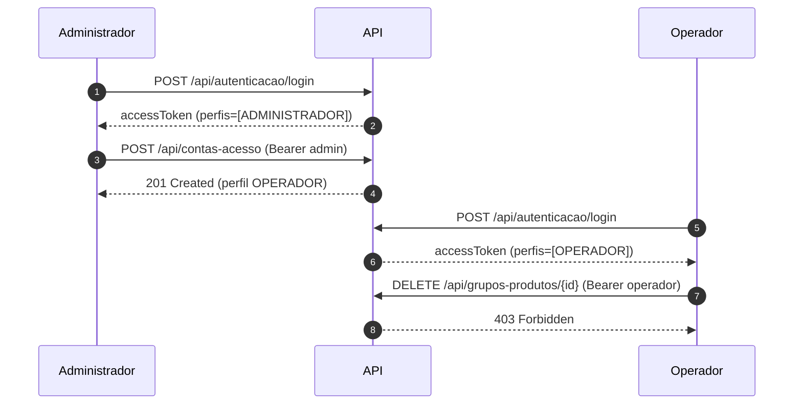
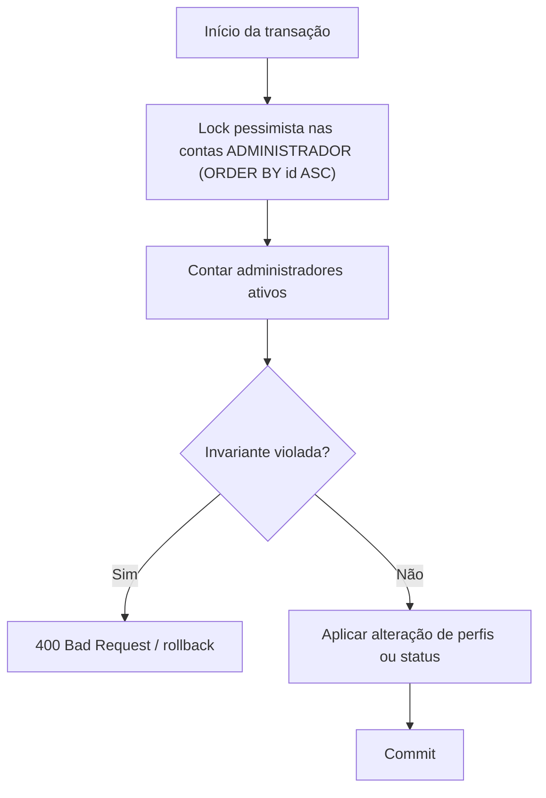
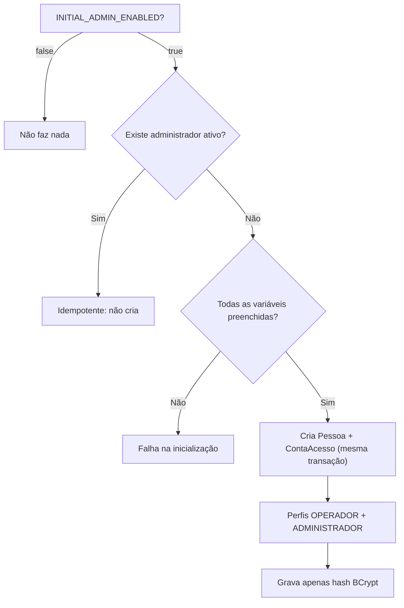

# Autorização por Perfis — Grossi Sports

Documento de apoio da Aula 14. Descreve o modelo de **controle de
acesso baseado em perfis** (RBAC) da API Grossi Sports: os perfis
`OPERADOR` e `ADMINISTRADOR`, a conversão do claim `perfis` do JWT em
authorities, a matriz de autorização, a diferença entre `401` e `403`,
a administração de contas, as invariantes que protegem o último
administrador e o *bootstrap* da primeira conta administrativa.

Este documento complementa [`autenticacao-jwt.md`](autenticacao-jwt.md),
que trata da autenticação (obtenção e validação do token).

## 1. Visão geral

A Aula 13 autenticou as requisições com **JWT Bearer**: a partir de
então, toda rota protegida exige um token válido, mas qualquer conta
autenticada tinha acesso a tudo. A Aula 14 introduz a **autorização**:
além de estar autenticada, a conta precisa possuir o **perfil** exigido
pela operação.

O modelo é *stateless*: os perfis viajam dentro do próprio token, no
claim `perfis`, e são derivados exclusivamente das authorities do
usuário no momento do login. O cliente **não** informa perfis no corpo
da requisição.

## 2. Perfis de acesso

| Perfil | Papel |
|---|---|
| `OPERADOR` | Executa o dia a dia: consultas e cadastros de produtos, grupos, fornecedores, pessoas, clientes, colaboradores, vendas e movimentações de estoque. |
| `ADMINISTRADOR` | Tudo o que o operador faz, **mais** a administração de contas de acesso (criar, alterar perfis e ativar/bloquear) e a exclusão de grupos de produtos. |

Uma conta pode acumular os dois perfis. Toda conta possui **ao menos um
perfil** — não existe conta sem perfil.

## 3. Do claim às authorities

O JWT emitido no login contém o claim `perfis`, por exemplo:

```json
{
  "sub": "operador.postman",
  "perfis": ["OPERADOR", "ADMINISTRADOR"]
}
```

O `SecurityConfig` registra um `JwtAuthenticationConverter` que lê esse
claim e o converte em authorities com o prefixo `ROLE_`:

```
perfis: ["OPERADOR", "ADMINISTRADOR"]
        │
        ▼
authorities: [ROLE_OPERADOR, ROLE_ADMINISTRADOR]
```

A partir daí, `hasRole('ADMINISTRADOR')` e `hasAnyRole('OPERADOR',
'ADMINISTRADOR')` funcionam tanto na política HTTP quanto em
`@PreAuthorize` nos serviços.

## 4. Matriz de autorização

| Operação | Público | OPERADOR | ADMINISTRADOR |
|---|:---:|:---:|:---:|
| `GET /api/health` | ✅ | ✅ | ✅ |
| OpenAPI / Swagger UI | ✅ | ✅ | ✅ |
| `POST /api/autenticacao/login` | ✅ | ✅ | ✅ |
| Demais rotas `/api/**` (produtos, grupos, fornecedores, pessoas, clientes, colaboradores, vendas, estoque) | ❌ | ✅ | ✅ |
| `POST /api/contas-acesso` | ❌ | ❌ | ✅ |
| `PUT /api/contas-acesso/{id}/perfis` | ❌ | ❌ | ✅ |
| `PUT /api/contas-acesso/{id}/status` | ❌ | ❌ | ✅ |
| `DELETE /api/grupos-produtos/**` | ❌ | ❌ | ✅ |
| Qualquer rota não classificada | ❌ | ❌ | ❌ |

A política é declarada em ordem, da mais específica para a mais geral, e
termina com `denyAll()`. Assim, uma rota nova que não seja
explicitamente classificada **não** fica pública por esquecimento.

> **Rota `/error`.** Ela **não** é liberada. Verificamos que o
> encaminhamento de erro não passa por estas regras nesta configuração:
> uma rota `/api/**` inexistente, com token válido, responde `404`
> (e não `403`), e os erros da API são tratados por
> `@RestControllerAdvice`. Liberar `/error` seria desnecessário e
> ampliaria a superfície pública.

> **Defesa em profundidade.** Além da política HTTP, os métodos
> administrativos de `ContaAcessoService` são anotados com
> `@PreAuthorize("hasRole('ADMINISTRADOR')")`. A proteção não depende de
> autoinvocação de métodos protegidos no mesmo *bean*.

## 5. `401 Unauthorized` versus `403 Forbidden`

Os dois códigos são diferentes e ajudam a diagnosticar o problema:

| Situação | Resposta |
|---|---|
| Sem cabeçalho `Authorization`, token malformado, assinatura inválida ou token expirado | `401 Unauthorized` |
| Token válido, mas a conta **não possui** o perfil exigido pela operação | `403 Forbidden` |

Em resumo: `401` significa "não sei quem você é"; `403` significa "sei
quem você é, mas você não tem permissão para isto".

## 6. Administração de contas

A criação pública de contas foi **encerrada** na Aula 14. Agora:

- `POST /api/contas-acesso` cria a pessoa e a conta na mesma transação,
  **sempre com o perfil `OPERADOR`**, e exige `ADMINISTRADOR`. O cliente
  não informa `pessoaId` nem perfis, o que impede vincular credenciais a
  uma pessoa existente ou autoconceder privilégios.
- `PUT /api/contas-acesso/{id}/perfis` substitui os perfis da conta.
  É a **única** forma de elevar alguém a administrador.
- `PUT /api/contas-acesso/{id}/status` ativa ou bloqueia a conta.



## 7. Invariantes administrativas

Para que o sistema nunca fique sem administrador e ninguém derrube a
própria conta por engano, o serviço impõe:

1. **Conta nunca sem perfil.** Uma lista de perfis vazia é rejeitada
   (`400 Bad Request`), tanto na validação da requisição quanto no
   domínio.
2. **Sem autobloqueio.** Um administrador não pode bloquear a própria
   conta.
3. **Sem autorrebaixamento.** Um administrador não pode remover o
   próprio perfil `ADMINISTRADOR`.
4. **Último administrador protegido.** O último administrador **ativo**
   não pode ser bloqueado nem perder o perfil `ADMINISTRADOR`.

A violação de qualquer invariante resulta em `400 Bad Request`, com a
transação revertida.

### 7.1 Concorrência e bloqueio pessimista

As invariantes 3 e 4 dependem de uma contagem (*quantos administradores
ativos existem?*). Se duas requisições concorrentes contassem ao mesmo
tempo, ambas poderiam concluir que "ainda resta um administrador" e
deixar o sistema sem administrador.

Para evitar isso, as transações de alteração de perfis e de status
adquirem, **no início**, um bloqueio pessimista de escrita
(`@Lock(PESSIMISTIC_WRITE)`) sobre as contas que possuem o perfil
`ADMINISTRADOR`, ordenadas por `id` ascendente. A ordem consistente de
bloqueio reduz o risco de *deadlock*.



## 8. Bootstrap do administrador inicial

Em um banco novo não existe administrador — e, como a criação de contas
exige `ADMINISTRADOR`, seria impossível criar o primeiro pelo fluxo
normal. A solução é um *bootstrap* opcional, controlado por variáveis de
ambiente (`INITIAL_ADMIN_*`), lidas do `.env` (fora do Git):

| Variável | Uso |
|---|---|
| `INITIAL_ADMIN_ENABLED` | Liga o *bootstrap* (`true`/`false`). Padrão: `false`. |
| `INITIAL_ADMIN_NAME` | Nome da pessoa administradora. |
| `INITIAL_ADMIN_EMAIL` | E-mail da pessoa administradora. |
| `INITIAL_ADMIN_CPF` | CPF da pessoa administradora. |
| `INITIAL_ADMIN_LOGIN` | Login da conta. |
| `INITIAL_ADMIN_PASSWORD` | Senha em texto aberto, usada **apenas** para gerar o hash BCrypt. |

Propriedades:

- **Desativado por padrão.** Só executa com
  `INITIAL_ADMIN_ENABLED=true`.
- **Validação clara.** Se habilitado com qualquer campo ausente, a
  inicialização falha com mensagem indicando a variável faltante.
- **Atômico.** A pessoa e a conta são criadas na mesma transação.
- **Perfis.** A conta recebe `OPERADOR` **e** `ADMINISTRADOR`.
- **Senha só como hash.** A senha nunca é armazenada em texto aberto;
  grava-se apenas o hash BCrypt.
- **Idempotente.** Se já existir administrador ativo, nada é criado.
- **Sem autenticação.** Usa os repositórios diretamente, sem chamar os
  casos de uso anotados com `@PreAuthorize`.

Após a primeira execução, recomenda-se desativar
`INITIAL_ADMIN_ENABLED` para reduzir a superfície operacional.



## 9. Limitações

- **Validade do token.** Um token já emitido continua válido até
  expirar (30 min), mesmo que a conta seja bloqueada ou perca um perfil
  nesse intervalo. A autorização usa os perfis *do token*, não uma
  consulta ao banco a cada requisição.
- **Sem revogação.** Não há *blacklist* de tokens nem *refresh token*.
- **Sem hierarquia de perfis.** Os perfis são planos; a distinção é
  feita por regras explícitas na política HTTP e em `@PreAuthorize`.
- **Chave simétrica (HS256).** Emissor e validador compartilham a mesma
  chave.
- **Auditoria simplificada.** As alterações administrativas não geram
  registro de auditoria dedicado nesta aula.

## 10. Referências no projeto

- Política de segurança e conversor JWT:
  `src/main/java/com/curso/grossisports/SecurityConfig.java`
- Casos de uso e invariantes:
  `src/main/java/com/curso/grossisports/service/ContaAcessoService.java`
- Repositório (lock pessimista):
  `src/main/java/com/curso/grossisports/repository/ContaAcessoRepository.java`
- *Bootstrap*:
  `src/main/java/com/curso/grossisports/service/AdministradorInicialService.java`,
  `src/main/java/com/curso/grossisports/security/AdministradorInicialRunner.java`,
  `src/main/java/com/curso/grossisports/security/AdministradorInicialProperties.java`
- Testes de autorização:
  `src/test/java/com/curso/grossisports/AutorizacaoApiTest.java`,
  `src/test/java/com/curso/grossisports/service/AdministradorInicialServiceTest.java`
- Autenticação JWT: [`autenticacao-jwt.md`](autenticacao-jwt.md)
- Contrato OpenAPI: `docs/api/api-docs.yaml`
